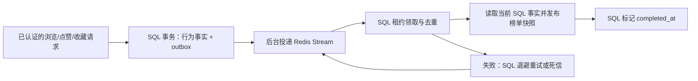

# 第六项：行为事件处理交付

日期：2026-10-08。完成顺序：功能实现 → 测试与修复 → 代码和架构审阅 → 本文档。六项功能已完成本地开发交付，本次没有部署或执行用户数据库迁移。

## 1. 结果与使用体验

浏览、点赞、取消点赞、收藏、取消收藏成功写入数据库时，在同一个 SQL 事务中追加行为通知。后台通过 Redis Streams 投递，消费者触发对应租户的今日/最受欢迎榜单刷新。HTTP 不等待 Redis 或统计任务；个人行为接口仍立即返回数据库结果。

普通情况下后台每秒轮询一次，榜单在消费完成后可见；这是最终一致性，不承诺固定一秒完成。积压、锁竞争、基础设施故障或重试会延长延迟。Redis 不可用时，行为仍能提交并保留待投递事件；榜单读取仍可回退 SQL。

沿用第四项统计口径：今日热门按当日最新浏览事实行统计不同用户，最受欢迎按当前点赞数与收藏数之和统计。重复浏览不会变成 PV 累加，重复点赞不会增加点赞事实行。

## 2. 数据流与一致性



- **事务发件箱**：`behavior_outbox.event_id` 是服务端 UUID 主键。行为与事件共用原仓储 Connection；事件写入失败时行为一起回滚，避免行为已提交但事件未保存的窗口。
- **至少一次投递**：消息只携带 `event_id`。SQL 保留完整身份、食谱和行为上下文。消费者根据 SQL 记录取租户，不接受消息中的身份字段。不同事件的顺序不影响统计正确性。
- **跨崩溃恢复**：未完成事件投递后 30 秒可再次投递；SQL 未完成状态持续保留。Redis 流丢失后重建 group，从 SQL 恢复待处理通知。消费者崩溃遗留的 Pending 消息通过 XAUTOCLAIM（空闲 30 秒）回收。
- **并发去重**：SQL 条件 UPDATE 领取 180 秒租约；同一事件同时只有一个有效领取者，过期 token 无法标记完成。完成事件的重复通知直接 ACK。
- **幂等业务效果**：刷新从当前 SQL 行重新聚合，并复用已有 Redis 榜单租约和原子发布。不会将消息转换成 ZINCRBY 累加。若榜单已经更新但 SQL 完成提交失败，重试重新计算同一个当前状态。
- **取消最后一个行为**：事件直接刷新指定租户，即使该租户已没有任何行为事实行，也发布空榜单，清除此前缓存。
- **消费确认**：成功、重试状态持久化后才 ACK；SQL 异常则保留 Pending。租约占用或重复通知可 ACK，因为未完成事件仍由 SQL 重新投递。

这里提供至少一次投递和幂等效果，不承诺消息仅执行一次。每次成功写入请求都会生成通知，包括重复 PUT/DELETE；业务事实仍幂等。此选择避免依赖不同数据库的 upsert rowcount 语义，代价是多一些可去重的刷新通知。

## 3. 重试、死信与恢复

消费者遇到刷新异常、Redis 榜单不可用或租约竞争，将失败状态写入 SQL，退避为 `min(300, 2^attempts)` 秒。默认最多 5 次失败；达到次数后设置 `dead_at`，停止自动投递。消息重放不能绕过 `retry_at`。错误仅记录固定分类，不记录可能含身份或凭据的异常文本。

业务死信保存在 SQL 发件箱，可检查：

```sql
SELECT event_id, kind, recipe_id, attempts, last_error, dead_at
FROM behavior_outbox
WHERE dead_at IS NOT NULL AND completed_at IS NULL
ORDER BY dead_at;
```

修复根因后，可在已配置数据库连接的维护进程调用：

```python
from safemeal.config.settings import settings
from safemeal.infrastructure.persistence.database import configure_database
from safemeal.infrastructure.persistence.behavior_outbox import SqlBehaviorOutbox

configure_database(settings.DATABASE_URL)
# 替换为检查过的死信 event_id；只有未完成死信可重置。
requeued = SqlBehaviorOutbox().requeue("<event_id>")
```

格式错误的 MQ 消息进入 Redis `safemeal:behavior:invalid:v1`，只保存消息 ID 与错误分类，近似保留最近 1000 条。未知合法 UUID 通知直接确认，不生成业务事件。业务事件流是 `safemeal:behavior:v1`，消费组为 `ranking-v1`。

消费完成的 Stream 条目 ACK 后删除；当前只支持这个消费组。将来新增订阅者时，必须先调整条目保留策略，不能直接共享这个删除策略。SQL 已完成事件保留作为去重和审计依据，本次不自动删除；部署方需制定保留期与定期清理策略。清理只能针对已完成事件，不能删除待处理或死信；已清理 ID 的旧消息会作为未知通知确认。

第四项定时榜单重建继续作为 Redis 数据恢复的兜底。死信需要维护人员检查和重新投递，不能将“进入死信”解释为该事件消费成功。不同租户的刷新互相隔离。

## 4. 配置、迁移与启用

新增迁移 `20261008_0012`，前置 `20261008_0011`。只新增 outbox 表和投递索引，不改写历史行为。迁移会检查行为表是否存在、outbox 是否冲突；不在应用启动时自动建表。

在目标数据库完成备份与迁移审核后，先执行：

```sh
alembic upgrade 20261008_0012
```

然后配置并重启服务：

```dotenv
BEHAVIOR_EVENT_REDIS_URL=redis://127.0.0.1:16379/3
BEHAVIOR_EVENT_BATCH=100
BEHAVIOR_EVENT_POLL_SECONDS=1
BEHAVIOR_EVENT_MAX_ATTEMPTS=5
RECIPE_RANKING_REDIS_URL=redis://127.0.0.1:16379/2
```

URL 默认为空，事件功能默认关闭；启用事件必须同时配置榜单 Redis，否则启动明确报错。`.env.example` 与 Docker Compose 已加入配置示例（容器使用 `redis://redis:6379/3`）。迁移必须先于启用：缺少 outbox 表时写事务失败并回滚，不静默忽略事件。

Redis 需要支持 Streams、consumer groups 和 XAUTOCLAIM（Redis 6.2+；项目 Compose 使用 Redis 7）。生产持久性仍由 SQL 发件箱承担。不同应用环境应隔离数据库/Redis；同一 Redis DB 的多个实例共同消费同一组。各实例时钟需同步，因为租约和重试时间使用服务端 UTC。

关闭事件功能可将 URL 清空后重启；SQL 行仍保留，再次启用会继续处理未完成事件。迁移 downgrade 会删除发件箱及其待处理记录，因此不能把它当成无损的功能关闭方式。

## 5. 测试结果

最终全量测试：**402 passed, 1 skipped**。第六项新增 **25 项**，使用临时 SQLite 和真实隔离 Redis Unix socket，覆盖：

| 范围 | 验证 |
|---|---|
| 事务边界 | 浏览/点赞/收藏附带事件；发件箱失败导致事实回滚；食谱不存在不产生事件 |
| 真实消息链路 | SQL → Stream → 消费 → Redis 榜单；租户隔离；浏览仍按不同用户统计 |
| 重复与乱序 | 完成事件重复消息不再刷新；取消最后一次点赞清空榜单；重复通知不能绕过退避 |
| 故障窗口 | Redis 不可用不阻断已提交行为；投递后 SQL 未标记可安全重放；榜单刷新后完成提交失败可恢复 |
| 恢复 | 流丢失重建；崩溃 Pending 回收；过期 SQL 租约可领取；旧 token 无法提交 |
| 运维与生命周期 | 重试耗尽 SQL 死信、人工 requeue、批次上限、后台任务启动去重与关闭等待 |
| Schema | 临时数据库迁移升级、重复迁移冲突检查、降级 |

Ruff：全部通过。Mypy：295 个源文件通过。全量回归包括前五项后端测试、HTTP 契约和架构边界测试，以及既有 Agent/记忆/约束回归。

测试报告：`evaluation_results/backend_feature_06_pytest.xml`；实施记录：`evaluation_results/backend_feature_06_iterations.json`。

**验证边界**：Docker daemon 不可用，未运行真实 MySQL 联调，也未迁移用户数据库。SQLite/Redis 测试不替代 MySQL 事务隔离、并发锁和迁移的部署验收；需要在真实 MySQL 测试环境完成这些检查再上线。原有 1 项跳过测试仍保留，不能视为已通过。

## 6. 测试后的架构审阅

| 文件/职责 | 审阅结论 |
|---|---|
| infrastructure/persistence/behavior_outbox.py | SQL 事务写入、租约、重试、死信和去重归持久化层；没有 HTTP 或 Agent 依赖 |
| reaction_repository.py / history_repository.py | 只在既有 SQL 写事务中插入事件，不直接访问 MQ；旧的默认构造保持可用 |
| infrastructure/messaging/behavior_worker.py | Redis Streams、Pending 回收、异步生命周期归基础设施层；阻塞调用通过 asyncio.to_thread 执行 |
| modules/interaction/application/ranking_service.py | 新增 refresh_tenant，复用事实聚合与榜单端口；业务模块没有导入 Redis、SQLAlchemy、配置或 Agent |
| bootstrap/composition/application_container.py | 统一注入发件箱、Redis 客户端和 Worker；关闭时先等事件任务，再释放 DB/Redis |
| migrations/20261008_0012_behavior_outbox.py | 固定 schema 定义，不导入运行时表模型，避免未来模型变化改变历史迁移 |
| HTTP 与 Agent | 没有新增内部维护 HTTP 接口；认证上下文和路由契约沿用前五项；Agent 图未改动 |

审阅修正了历史迁移对运行时表定义的依赖，并增加消费完成提交失败、重复通知退避、浏览口径、批量边界测试；最终全量回归通过后复查上述依赖方向。未发现本次改动违反当前架构的阻断问题。

## 7. 六项状态

食谱列表与详情、点赞与收藏、浏览历史、热门榜单、用户身份与行为管理、行为事件处理，均已完成实现、测试、架构审阅和文档交付。本次工作停在第六项交付，不自动部署或扩展其他功能。
