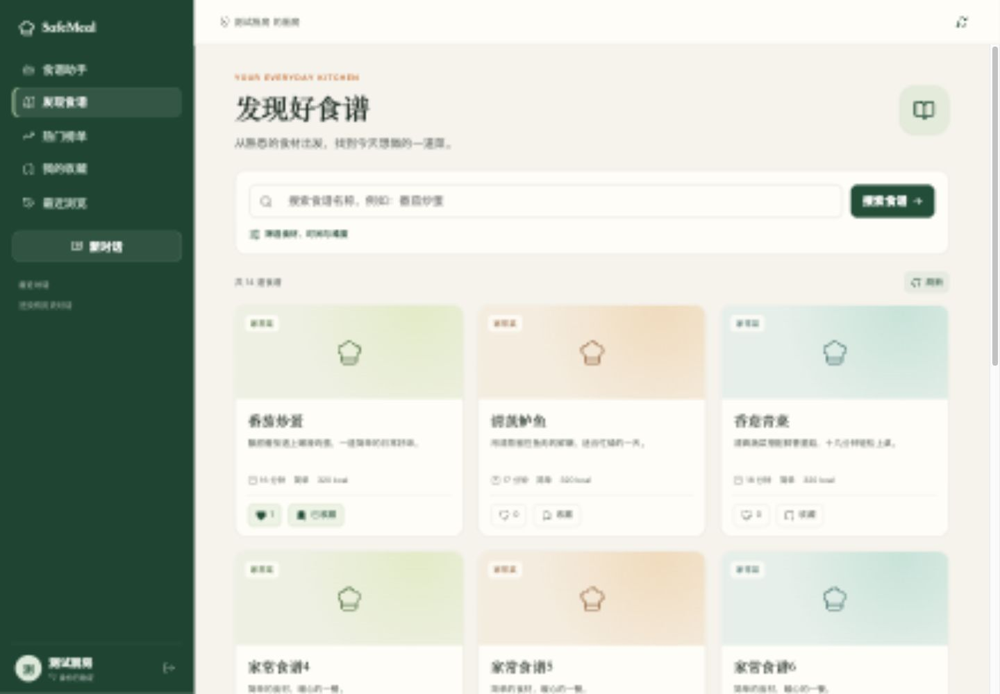
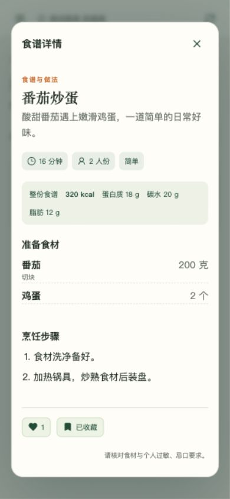

# SafeMeal 前端功能补充

日期：2026-10-09。基于现有 React + Vite 前端补齐此前六项后端能力的用户入口，保留原有登录、注册和 Agent 对话。

## 完成内容

| 入口 | 新增能力 |
|---|---|
| 发现食谱 | 名称搜索；菜系、难度、包含/排除食材、用时、热量筛选；名称/用时/热量排序；分页 |
| 食谱详情 | 原生模态对话框；食材、准备说明、步骤、人数、时间、难度与营养信息；Escape 关闭 |
| 点赞与收藏 | PUT/DELETE 对接已有接口；当前状态与点赞数；操作期间禁止同一道食谱重复提交 |
| 我的收藏 | 本人收藏分页；打开详情；取消后重新加载列表 |
| 最近浏览 | 成功打开目录详情后自动上报浏览；历史按服务端 cursor 翻页，不用 offset 替代 |
| 热门榜单 | 今日热门/最受欢迎切换；排名与对应分数、更新时间；提示统计稍后更新 |
| 登录与连接 | 复用现有账号；并发请求共享刷新；登录页可设置后端地址；切换地址清除旧连接令牌 |

第六项 MQ 处理是后端机制，其用户可见结果体现在榜单刷新，前端不增加消息队列管理页面。Agent 生成的食谱复用新的内容组件，但不会将未确认属于目录的生成食谱自动写入浏览历史。

## 使用

在项目根目录：

```sh
npm run dev --prefix web
```

打开 `http://localhost:5173`。默认后端地址是 `http://localhost:8000`；可在登录页展开「连接设置」保存其他地址。需先启动真实后端并完成前六项所需迁移，前端不会执行数据库迁移。

```sh
npm test --prefix web
npm run build --prefix web
npm run preview --prefix web
```

`preview` 默认端口 4173。若使用 127.0.0.1 或 4173，后端 `CORS_ORIGINS` 需要明确包含相应前端 Origin，例如 `http://127.0.0.1:4173`；现有示例配置默认允许 `http://localhost:5173`。生产环境按实际域名配置。

## 界面与交互

沿用森林绿导航、米白背景和柔和卡片。桌面三列、中等屏幕两列、手机一列；手机使用可展开侧栏。补充加载、空列表、请求错误与重试状态。模态详情聚焦于当前食谱，打开后背景不可交互，支持键盘关闭；减少动画偏好得到尊重。

页面发出请求后切换筛选、分页或入口时，过期响应不再覆盖当前页面。写操作以服务端返回状态为准，没有先加计数再回滚的乐观累计。详情内也显示操作失败，浏览上报失败不会隐藏已读取的食谱。

食材读取支持后端规范结构 `ingredient.name`，兼容原 Agent 的平铺名称。营养信息按 `basis` 展示「整份食谱」或「每 100 克」，不把整份热量标成每人份。收藏 SQL 无时区时间按 UTC 解释，与带时区的历史时间统一显示为浏览器本地时间。

URL 切换只在保存时生效，输入过程中不发送令牌。刷新、认证和 SSE 回调检查登录代次，退出或更换连接后的旧结果不能恢复已退出的身份或覆盖新身份的聊天数据。

## 验证与审阅

- Node 原生单元测试：**6 项通过**。覆盖筛选参数编码、食材多值和上限、零值、目录/个人列表结构、错误映射、时间解释。
- Vite 生产构建：通过。没有增加生产 npm 依赖。
- 后端全量回归：**402 项通过，1 项原有跳过**。报告位于 `evaluation_results/frontend_completion_pytest.xml`。
- 实际浏览器验收：使用隔离的内存 API 与虚构账号，验证登录、列表分页、名称筛选、详情、点赞、收藏与取消、收藏空状态、历史、两种榜单、无匹配结果、503 与重试恢复、Escape 关闭、刷新令牌共享。
- 请求记录确认：过期测试令牌登录后，会话与目录请求共用刷新结果，只发出 1 次 `/auth/refresh`。
- 响应式检查：1440 × 1000 与 390 × 844；390px 下单列，页面 scrollWidth 与 clientWidth 均为 390，无横向溢出。
- 浏览器检查未见未捕获运行时异常。`git diff --check` 通过。

浏览器测试使用 `web/tests/fixture_server.py`，不连接项目数据库、不调用外部模型、不修改真实账号。该脚本仅用于本地合成数据验收，不是认证实现或生产服务。真实后端部署和真实 MySQL 联调不属于本次验证；不能将模拟浏览器验收解释为已完成生产联调。原 Agent SSE 的真实模型生成没有重新在线调用。

审阅结论：`App.jsx` 负责既有身份和导航；`RecipeWorkspace.jsx` 负责目录与行为页面；`RecipeContent.jsx` 负责共享展示；`recipes.js` 负责 HTTP 参数与展示适配。所有身份来自既有认证，行为请求不传用户/租户 ID。列表只展示页面数据，用一次批量接口读取当前页交互状态，避免逐卡片请求；后端与 Agent 架构没有改动。

## 预览证据

截图均为虚构测试数据：





实施与验证记录：`evaluation_results/frontend_completion.json`。
