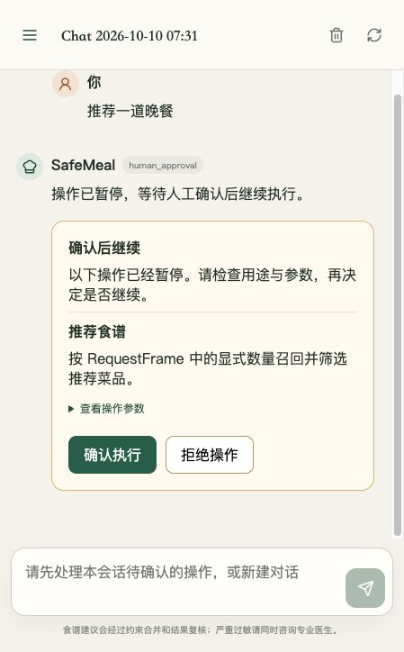

# Agent 第三项：审批界面与恢复流程（第 8/9 份）

日期：2026-10-10。完成本项后等待确认，再开始最后一项「检索质量与消融」。

## 已完成的用户流程

Agent 返回待审批操作时，聊天中显示操作名称、用途、参数预览和「确认执行」「拒绝操作」按钮。用户不能编辑工具参数。提交期间按钮和输入框禁用；恢复后显示经过安全复核的回答或拒绝结果。恢复结果、来源与食谱卡片写回原待确认消息，刷新和历史查询能看到一致的结果。

当前会话保存在浏览器 sessionStorage 中，绑定后端地址、账号与租户。刷新后登录验证完成，再读取该账号的历史会话，直接恢复待审批卡片；退出登录或新建对话会清除记录。异步历史加载检查账号和导航版本，避免过期请求覆盖另一会话。

生产配置仍默认保护 `generate_recipe`，没有取消人工审批。浏览器演示为了不产生模型费用，使用隔离的推荐工具作为受保护操作；生成食谱的同意、拒绝与最终安全复核另有自动化测试。



## 修复的后端缺口

原来的恢复路由校验会话归属后直接调用 Workflow，缺少具体审批标识、恢复结果落库以及重复提交保护。本次恢复进入 `ChatTurnService`，按以下顺序执行：

1. 在 SQL 事务中校验登录用户拥有会话、待审批消息属于该会话，并核对审批标识。
2. 通过条件 UPDATE 原子地把该审批从待处理改为处理中；同一事务保存审批标识、同意/拒绝决定、原操作预览和 UTC 时间。
3. 从持久化检查点恢复 Agent，而不是把用户问题重新发送给模型。检查点没有中断或已恢复时返回明确错误。
4. 同意后执行已保存的工具计划，拒绝清空待执行调用。内部决定也只接受显式 True，不把字符串 `"false"` 当成同意。
5. 经 Workflow 的约束解析与最终安全复核后，把结果写回原消息。仍有新的审批时生成新的标识，旧标识不能恢复下一轮。

同一会话有待审批操作、审批执行中或尚未结束的普通轮次时，不允许开始另一轮聊天或清空消息。这既防止误覆盖检查点，也防止一个审批预览意外恢复另一请求的工具计划。

没有新增数据表或迁移。复用现有 `chat_messages.message_metadata` 存储审批数据，以及 agent_response 的 nullable `turn_status` 存储执行状态；user_query 的 turn_status 仍表示普通聊天轮次状态。

|状态|持久化表示|用户可以做什么|
|---|---|---|
|待审批|approval_required=true，turn_status=NULL|检查预览，同意或拒绝|
|恢复执行中|turn_status=processing，决策已落库|等待结果或刷新查看状态，不能重复提交|
|已同意并结束|approval_state=approved，turn_status=completed|查看最终回答，继续聊天|
|已拒绝|approval_state=rejected，turn_status=completed|查看拒绝结果，继续聊天|
|恢复失败或执行结果不明|turn_status=failed；进程中断可能仍为 processing|保留会话供维护者核查，可另开新对话|

`approved` 表示已同意且恢复流程结束，食谱能否发布仍由 `safety_review` 决定；审批不覆盖过敏与食材证据校验。

## 接口契约

`POST /api/v1/chat/resume` 使用登录令牌，并发送 JSON：

```json
{
  "session_id": "当前会话ID",
  "message_id": 2,
  "approval_id": "待审批消息metadata中的approval_id",
  "approved": true
}
```

必须发送 `Content-Type: application/json`。message_id 来自原聊天响应或历史消息；approval_id 来自服务器，不能由客户端自行生成。approved 必须是 JSON 布尔值，不能发送字符串。工具参数和 user_id 均不属于该请求模型。

|情况|HTTP 结果|
|---|---|
|未登录|401|
|会话或消息不属于当前用户|404|
|旧审批、重复提交、执行中或已结束的审批|409|
|缺少新增标识、非法字段或非布尔决定|422|
|完成恢复|200，返回 AgentProcessResponse|
|Agent 返回执行错误|200，status=error，前端显示失败状态|

返回 metadata.message_id 指向同一条被更新的聊天消息，metadata.approval_history 保留已提交的决定。恢复结果不是新增一轮用户问题，也不会新增重复的助手回复。

这收紧了旧恢复接口：只发送 session_id 与 approved 的旧客户端会收到 422，需要读取服务器下发的消息与审批标识。旧历史消息若缺少审批标识，前端禁用确认按钮，不自行补造标识。

## 验证与发现

新增十五项后端测试，使用真实临时 SQL 数据库、持久化 SQLite 检查点和确定性模型/工具替身，覆盖：

- 同意和拒绝前均无工具执行；同意后执行一次，拒绝不执行。
- 重新构造 Agent、图和检查点适配器后恢复同一中断，并经过最终安全复核。
- 同一条消息持久化最终结果及一次审批决策；重复请求不再调用工具。
- 四个并发 SQL 认领请求仅一个成功，处理中决定已持久化。
- 旧标识不能恢复下一轮审批；待审批和普通处理中轮次不能被新请求覆盖。
- 跨用户访问、严格布尔值校验、HTTP 状态码与历史一致性。
- 工具抛错、模型回答超时、检查点丢失，均保存失败状态并拦截重放。模型超时测试确认实际进入了模型替身的 answer 方法。
- 默认受保护的生成工具在同意前不执行，同意后生成卡片并复核，拒绝不发布卡片。

另用完整应用装配、真实账号注册、JWT 鉴权与 HTTP TestClient 验证同意/拒绝两条闭环，没有替换鉴权。两个账号相互隔离，待审批时重建 Agent 和检查点适配器后仍能恢复。证据中同意新增一次工具执行，拒绝新增零次；401、404、409 与审计记录均符合预期。

浏览器验证使用真实 React 前端与本机隔离 API，走通登录、SSE 待审批回复、展开参数、刷新恢复、同意和拒绝。验证发现并修复了：刷新丢失当前会话、审批请求缺少 JSON 请求头导致 422，以及普通失败消息被误认为审批的问题。审批卡片在本次浏览器窄窗口中按钮可用，未宣称完成所有设备与浏览器兼容性验收。

前端十项测试通过，其中四项覆盖审批标识、不可重放状态、按账号/后端恢复会话及普通轮次与审批状态区分；Vite 生产构建通过。最终全量 486 项通过、25 项跳过（11.76 秒）；专项回归 27 项通过，包含新增的十五项与十二项原历史/上下文回归。Ruff、Mypy（306 个源文件）及 diff 检查通过，代码哈希见验证记录。全量测试的 25 个跳过项保持明确，不计为已运行的真实基础设施验收。

为支持同会话并发保护，原历史上下文测试夹具中的「后续消息」补上了正常完成的回复；保留了原有历史锚点和排除当前问题的断言，没有删除或放宽业务测试。

## 架构审阅

- HTTP 路由只做身份绑定、协议模型与异常映射；恢复与聊天共用 ChatTurnService，不在路由内直接操作检查点或数据库。
- AgentExecutionService 负责恢复检查点与执行时限，审批图节点只决定放行或拒绝；Workflow 继续负责发布前安全复核。
- Conversation 应用层通过 UoW/Repository 端口校验归属并持久化决定；SQLAlchemy 适配器实现条件更新，避免仅靠进程内锁防重，多进程同样使用数据库认领。
- React 审批展示放在 ApprovalCard，状态与请求标识检查放在 approval.js，App 负责会话/API 协调。按钮本地锁只是交互保护，数据库才是提交防重边界。
- 不新增队列或服务，不向精简传统后端装配引入 Agent SDK。审批没有跳过约束解析或安全复核。

审阅补充修正：认领前再次核对读取的审批标识，避免事务读到旧预览却认领新标识；决策在执行前原子落库，避免执行中断后丢失已提交决定；检查点读取和执行共享恢复时限。

## 恢复边界与限制

待审批但尚未提交的任务可在重建运行组件后恢复；本次自动化验证使用持久化 SQLite 文件，未把同进程组件重建说成完整服务进程宕机演练，也未新增 PostgreSQL 集群验收。

SQL 与 LangGraph 检查点仍是两个独立持久化边界。认领后进程中断、工具执行后结果未写回、或执行状态无法确定时，保留 processing/failed 并禁止自动再次执行。维护者需先核对同一会话的审批审计、checkpoint 中的中断/工具结果及实际副作用，再决定如何处理；本项没有提供把状态直接重置后重放的接口，也没有保证外部副作用 exactly-once。

审批结果写回失败时，客户端先重新加载服务端历史，不能仅根据网络错误认定工具未执行。若结果已写入，刷新能显示完成；若仍为 processing/failed，界面明确显示需核查。缺失检查点不伪造成功结果。

本项不新增记忆管理或知识上传界面，也不处理上一项知识问答的事实准确性风险；最后一项将评估检索质量与证据引用。本次验证未调用付费模型服务。

## 文件与复现

实现文件：

- `safemeal/agent/contracts/api.py`、`gateway/service.py`、`gateway/chat_turn_service.py`。
- `safemeal/agent/runtime/orchestration/nodes/approval.py`。
- `safemeal/modules/conversation/application/turn_persistence.py`、`chat_session_service.py`、`ports/chat_repository.py`。
- `safemeal/infrastructure/persistence/chat_repository.py`、`interfaces/http/routers/chat.py`。
- `web/src/App.jsx`、`components/ApprovalCard.jsx`、`approval.js`、`styles.css`。

验收文件：

- [完整应用注册/JWT 验证](../../evaluation_results/agent_approval_authenticated.json)
- [全量回归](../../evaluation_results/agent_approval_regression.xml)
- [专项回归](../../evaluation_results/agent_approval_cases.xml)
- [验证与架构记录](../../evaluation_results/agent_approval_validation.json)
- [同意结果截图](../../evaluation_results/agent_approval_completed.jpg)
- [拒绝结果截图](../../evaluation_results/agent_approval_rejected.jpg)

```sh
make test-agent-approval
```

该目标运行持久化审批测试、完整应用的注册/JWT 验证与前端测试构建。`scripts/evaluate_agent_approval.py` 仅是评测入口，复用测试模型/工具替身；每次创建并清理自己的临时存储，生成临时 JWT 密钥，不读取日常聊天数据，不执行供应商请求。生产装配不依赖测试文件。
